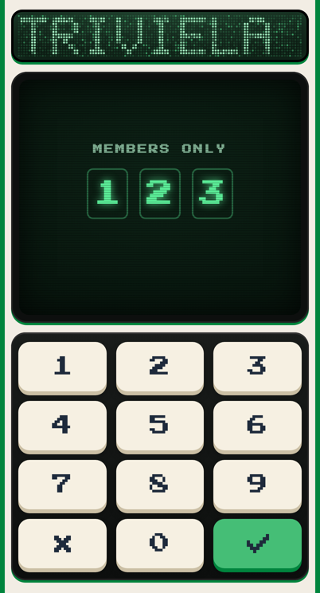
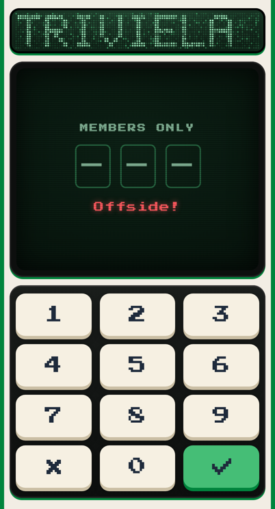
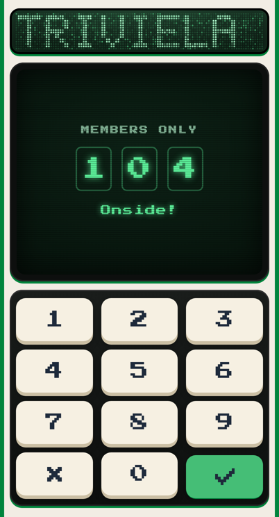

# The 104 lock (built Oct 19, 2026, switched off the same day)

A members-only number pad for the real site: faux exclusivity while Morg tested Triviela live, not security. The code is 104, a wink to the 104 Boyz, the same pad and code as OP Hiker’s gate. Morg switched it off on Oct 19, 2026, in case people start texting the link.

## Bring it back
In `build/template.html`, set `var LOCK = true;`, rebuild and push. Every phone then asks once. To ask again on phones that already got in, change the remember key `bsb-104` to a new one. Until then, `?gate` on a preview link shows it, for example https://daily.blank-space-baby.pages.dev/?gate

## What it looks like
The cabinet itself is the lock (`lock()` in the template, view `gate`, screen `#v-gate`, panel `#p-gate`).
- The screen shows MEMBERS ONLY in small dim arcade letters, then three code slots, glowing green Press Start 2P digits in outlined boxes, each reading “–” until a digit lands. Digits show, not dots.
- The panel is a 3×4 pad of cream push-buttons like the tiles, in phone order: 1 2 3 / 4 5 6 / 7 8 9 / ✕ 0 ✓. A 3×3 has no room for 0. The ✕ (Clear) is the pixel ✕, and the ✓ (Enter) is the pixel ✓ on the green key. Keys 62 pt tall, 50 pt on short phones, 12 pt apart.
- The menu button hides while the lock shows.

  

## How it behaves (OP Scout’s spec for OP Hiker’s gate, Oct 19, 2026: its behavior, our art)
- A key shows pressed on touch and fires once, on release inside the same key. Sliding off or a system cancel cancels it. One finger at a time.
- No double fire: a tap’s own click never fires again. Click fires only if no finger touched that key in the last 600 ms, which is the keyboard and VoiceOver path.
- Keyboard: digits type, Backspace or Escape clears, Enter tries the code.
- A fourth digit is ignored, and ✕ clears all three.
- Touches drop for 350 ms after the pad appears (the tap shield).
- **Wrong code:** the slots shake side to side for 0.45 s, decaying, and roll back to “–” one by one, 60 ms apart. “Offside!” shows in red for 1.8 s, announced to screen readers. Android vibrates [40, 50, 40]. Nothing fires during the 450 ms rattle. Reduce Motion: no shake.
- **Right code:** the ✓ stays pressed, “Onside!” shows, 0.62 s of stillness (a tap skips it), an 18 ms vibration where there is one, and the phone is remembered at once (`bsb-104`). Then the screen powers on like an old CRT, a bright line opening out to the picture, while the sign flickers on, and the day opens as usual, with How to play after it if due.
- **Return visits** skip the lock. Private browsing that can’t store asks again. On iPhone, Safari and a Home Screen app keep separate storage, so each asks once.
- Preview links and the test tools skip it.

The words MEMBERS ONLY, Offside! and Onside! were placeholders Morg hadn’t signed off on yet.

OP Scout’s full spec for OP Hiker’s gate, with its curtain reveal and module layout, came by message on Oct 19, 2026. OP Hiker’s modules are web/js/ui/gate.js, gate-art.js, gate.css and hold.js in that project’s repo.
